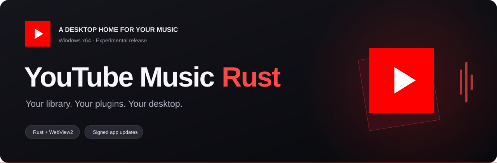

<a href="https://github.com/StonkyWasTaken/youtube-music-rust-releases/releases/latest">Release notes &amp; all downloads</a> · <a href="https://github.com/StonkyWasTaken/youtube-music-rust-releases/issues">Report a bug</a>

> **The Windows download is live.** Install once, then get future updates inside the app.

## Music, with room to make it yours

An independent Windows desktop client for YouTube Music, built with **Rust + WebView2**. Keep your music in its own window and customize how the player works.

**This is an experimental project.** Some features and plugin ports are still in progress.

- **Desktop playback** — native menus, tray playback, media shortcuts and always-on-top.
- **Your setup** — an integrated plugin panel, equalizer, playback speed and audio output selection.
- **Precise volume** — scroll over the artwork to adjust volume in fine steps.
- **Discord presence** — show what you are listening to, with your own activity name and title.
- **Lyrics and extras** — synchronized lyrics, artwork effects and the original In player ad blocker mode.
- **Remember your queue** — keeps the song and queue when you reopen, starting the song at 0:00.

## New in 0.3.0

**Nine new experimental plugin ports** bring the catalog to **37 available ports out of 40**:

- Album Actions, Downloader, and Last.fm / ListenBrainz Scrobbler.
- An authenticated local API and authenticated SOCKS5 Proxy Adapter.
- In-App Menu, Windows Taskbar Media Control, Transparent Player, and Performance Improvement.

New plugins are off by default. Enable them in **Settings and plugins** and configure tools or credentials under **Options**. Downloads use yt-dlp with Deno or Node; MP3 also needs FFmpeg. Proxy, performance scripts, and transparency need a restart.

Crossfade, Music Together, and the macOS Touch Bar remain unavailable. These ports are experimental; live service compatibility and complete upstream parity are still being verified.

[Read the full update log](CHANGELOG.md) · [0.3.0 release notes](https://github.com/StonkyWasTaken/youtube-music-rust-releases/releases/tag/v0.3.0)

## Install in three steps

1. Click **Download for Windows** above and run `YouTube-Music-Rust-Setup.exe`.
2. Open the app. Sign in to YouTube Music if you want access to your library.
3. Press **Ctrl+,** to open Settings & plugins and make it yours.

You need **64-bit Windows** and Microsoft **WebView2**. The installer handles WebView2 setup when needed.

<b>Not sure what to download on GitHub?</b>

Use the red download button above, or choose the `.exe` installer under **Assets** on the latest release page. You do not need the green **Code** button, the source archives, `.sig` files or `latest.json`.

## Updates that come to you

Install the update-enabled version once. Future versions will show **Update available** in the app and in a Windows notification.

Choose **Application → Check for updates…** whenever you want to check manually. The app downloads and installs an update only after you confirm. Your settings and separate music profile are kept.

Update packages are verified with a signing key before installation. The Windows installer does not yet have an Authenticode certificate; these are separate signing systems.

## Downloads public. Source private.

This repository hosts installers, update files, release notes and license notices. The application source is maintained in a separate private repository.

Based in part on [pear-devs/pear-desktop](https://github.com/pear-devs/pear-desktop), version 3.12.0. MIT attribution is included in [LICENSE](LICENSE), [UPSTREAM-LICENSE](UPSTREAM-LICENSE) and with the downloadable installer.

Unofficial project · Not affiliated with Google or YouTube

